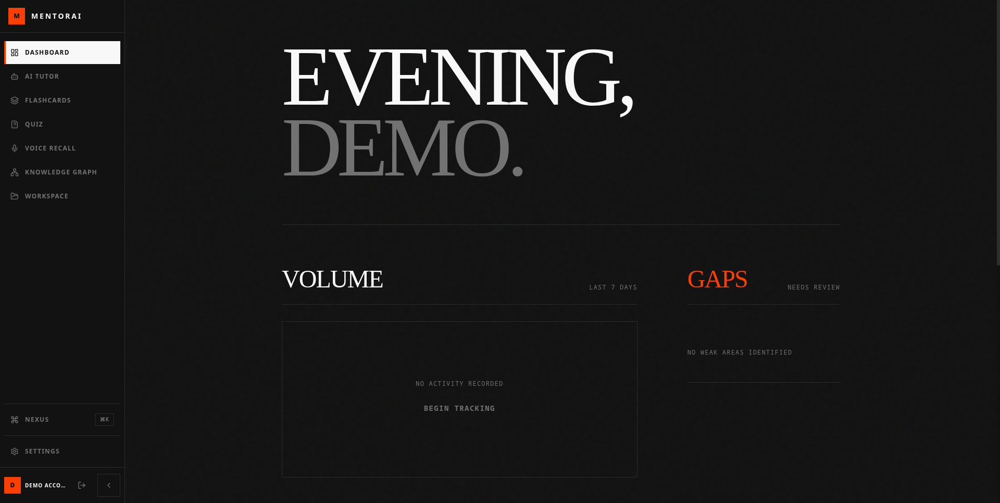

# Mentorai — Intelligent Study Platform

One-line tagline: A pragmatic, engineering-first platform for active recall, spaced repetition, and AI-assisted study workflows.

---

## Project Overview

Mentorai addresses a common productivity problem for knowledge workers and learners: fragmented study material and weak retention. It bundles a compact study engine, content ingestion pipelines, and lightweight AI automation to help users capture, schedule, and rehearse factual knowledge with measurable recall metrics.

Core product behavior:
- Users create or import study decks (flashcards, notes, documents).
- The system schedules reviews using an SM-2 inspired spaced-repetition algorithm and tracks mastery metrics per card.
- An integrated review UI and focused weak-card workflow lets users prioritize low-mastery items.
- Background services perform transcription, ingestion (PDFs), and optional model-assisted card generation.

Primary workflow:
1. Ingest / author content in the web client.
2. Server normalizes and stores items in the database.
3. Scheduler computes next-review dates and surfaces due cards in the study UI.
4. Users review cards; responses feed back into the scheduler to update mastery and next-review times.

---

## Core Features

- Spaced-repetition engine with per-card mastery scoring and next-review computation.
- Focused “weak card” session that prioritizes low-mastery items for efficient study.
- Client-side UX for fast reviews, batch creation, and deck management.
- Server-side ingestion: PDF parsing and transcription (Whisper) pipelines.
- AI-assisted workflows: optional card generation and summarization via model APIs.
- Background processing for transcription, indexing, and analytics aggregation.
- Role-aware routes and basic admin panels for deck management and content moderation.
- Metrics and reporting for daily review volume, mastery distribution, and retention trends.

---

## Tech Stack

- Frontend
  - Vite + React + TypeScript
  - Tailwind CSS (utility-first UI) and Framer Motion for interactions

- Backend
  - Node.js (Express) API server
  - Background worker processes for long-running tasks (transcription, parsing)

- Database
  - Document-store (MongoDB / Mongoose models) for flexible content and review logs

- AI / Automation
  - Speech-to-text (OpenAI Whisper or self-hosted Whisper server) for audio transcription
  - Model orchestration via OpenRouter / API adapter layer for generation and summarization
  - Scheduling algorithm (SM-2 inspired) implemented server-side

- Deployment / Infrastructure
  - Container-friendly services (server + workers + optional whisper service)
  - Static-hosted client (CDN-friendly) with API backend
  - Monitoring hooks, basic rate limiting, and request logging middleware

---

## System Architecture / Workflow

High level data flow:

1. Client actions (create deck, add card, start session) call REST endpoints on the API server.
2. API server persists objects (Deck, Card, StudySession, StudyLog) to MongoDB and returns minimal payloads to the client for snappy UI updates.
3. When ingestion tasks are required (PDF, audio), the API enqueues a background job. Workers pick up jobs, parse inputs, generate candidate cards, and write results back to the database.
4. Scheduler component (cron or job queue) evaluates due items and updates review metadata; reads are optimized via indexed nextReview fields.
5. AI calls are routed through an adapter layer (OpenRouter / provider) to keep API usage consistent, batch-able, and auditable.

API communication and contracts:
- REST endpoints follow resource-centric semantics: `/api/decks`, `/api/cards`, `/api/study-sessions`, `/api/weak-cards`.
- Responses are deliberate and compact: lists are paginated, and study sessions return only the active card subset.
- Long-running tasks return job IDs and status endpoints for polling.

Background workflows and automation:
- Transcription worker: accepts audio, calls Whisper, normalizes timestamps, and stores transcripts and extracted candidate cards.
- PDF parser: extracts plaintext, segments into candidate cards, and sends candidate suggestions to a review queue.
- Card-generation pipeline: optional model call to propose Q/A pairs from source text; proposals require human review before becoming canonical cards.

Data considerations:
- Mastery and scheduling fields are indexed (`nextReview`, `deckId`, `mastery`) to support fast queries for due items and analytics.
- Study logs are append-only for auditability and to support retention curve analysis.

---

## Engineering Challenges Solved

- Scheduling correctness: moved from client-side heuristics to server-side scheduled computations to ensure determinism across devices.
- Scalability for ingestion: separated ingestion into worker processes to avoid blocking API throughput and to enable horizontal scaling.
- Rate limiting and API abstraction: created an adapter layer for model APIs to centralize rate limiting, monitoring, and provider failover.
- Data modeling for analytics: designed compact study logs that can be aggregated into retention and mastery reports without heavy joins.
- UX performance: minimized payloads and used optimistic UI updates to make review sessions feel real-time.

---

## Screenshots (placeholders)

- Dashboard
  -  — Dashboard with study summary and mastery distribution

- Workflow (ingest → review)
  -  — Content ingestion and card suggestion pipeline

- Study UI
  -  — Fast-paced recall interface

- Architecture diagram
  -  — System components and data flow

- Automation flow
  -  — Transcription and card-generation pipeline

- Analytics pages
  -  — Retention curves and daily volume

- Admin panels
  -  — Deck and user moderation tools

> Replace these images with actual screenshots in `docs/screenshots/` when preparing a public portfolio.

---

## Future Improvements (realistic roadmap)

- Scale & reliability:
  - Move workers to managed queues (e.g., Redis Queue / Bull / managed cloud queues) for better retry and observability.
  - Add circuit breakers and provider failover for model APIs.

- Product and features:
  - Improve card suggestion quality with a small fine-tuned model and feedback loop from human edits.
  - Add collaborative decks and sharing with read-only or curator roles.

- Observability & ops:
  - Add end-to-end tracing for ingestion pipelines.
  - Ship usage dashboards and SLO alerts for background workers.

---

## Key Engineering Learnings

- Keep scheduling deterministic: centralize the scheduling logic server-side to avoid cross-device inconsistencies.
- Treat AI calls as unreliable IO: put model interactions behind adapters and fallbacks, and track prompt/response metadata for debugging.
- Separate ingestion from user-facing APIs: user latency and throughput improve when heavy tasks are offloaded to workers.
- Design data models for aggregation: storing lightweight study logs enables fast analytics without expensive joins.

---

## Footer

For portfolio, contact, or hiring inquiries:

- Portfolio: [your-portfolio-url]
- LinkedIn: [your-linkedin]
- Email: [your-email@example.com]

If you'd like, I can adapt this README to include concrete screenshots and a short tech summary tailored to a hiring deck.
# MentorAI


MentorAI is a full-stack AI learning platform for note-taking, flashcards, quizzes, voice recall, tutoring, and study analytics. It combines a React + Vite frontend, an Express backend, MongoDB Atlas, local AI options, and cloud fallback services to support production deployment on Vercel and Render.

## Features

- AI Tutor for guided explanations and Socratic practice
- Notes with summarization, translation, PDF import, and editing
- Flashcards with spaced repetition and deck management
- Dashboard with study streaks, weak topics, and activity summaries
- Quiz generation, submission, history, and analytics
- Knowledge Graph for connecting notes, concepts, quizzes, flashcards, and voice sessions
- Voice Recall with Whisper-based transcription support

## Tech Stack

| Layer | Technology | Purpose |
|---|---|---|
| Frontend | React | UI and application shell |
| Frontend Tooling | Vite | Fast development and production builds |
| Backend | Node.js | Runtime for the API server |
| Backend Framework | Express | REST API and middleware |
| Database | MongoDB Atlas | Persistent storage for users and study data |
| Local AI | Ollama | Development-time model access |
| Cloud AI | OpenRouter | Production-safe AI fallback |
| Auth | JWT | Cookie-based authentication |

## Live Demo

- https://mentorai.vercel.app

## Getting Started

### Prerequisites

- Node.js 18+ and npm
- MongoDB Atlas database
- OpenRouter API key
- Optional: Ollama for local development
- Optional: Whisper server for speech transcription

### Installation

1. Clone the repository.
2. Install dependencies in both app folders.
3. Configure environment variables using the example files.
4. Start the backend and frontend locally.

### Environment Setup

Use [server/.env.example](server/.env.example) as the template for backend variables.

Copy it to `server/.env` and fill in the real values for:

- `MONGO_URI`
- `JWT_SECRET`
- `OPENROUTER_API_KEY`
- `NODE_ENV`
- `CLIENT_URL`
- `WHISPER_SERVER_URL`
- `OLLAMA_URL`
- `OLLAMA_MODEL`
- `OPENROUTER_MODEL`
- `DEMO_EMAIL`
- `DEMO_PASSWORD`

For the frontend, use these values:

- [client/.env.development](client/.env.development) for local development
- [client/.env.production](client/.env.production) for deployed builds

### Run Locally

From the project root:

```bash
./start.sh
```

If you prefer manual startup:

```bash
cd server
npm install
npm run dev
```

In another terminal:

```bash
cd client
npm install
npm run dev
```

## Environment Variables

### Backend

| Variable | Purpose |
|---|---|
| `MONGO_URI` | MongoDB Atlas connection string |
| `JWT_SECRET` | JWT signing secret |
| `OPENROUTER_API_KEY` | OpenRouter API key |
| `NODE_ENV` | Environment mode (`development` or `production`) |
| `CLIENT_URL` | Frontend origin used for CORS and AI requests |
| `WHISPER_SERVER_URL` | Optional local Whisper service URL |
| `OLLAMA_URL` | Optional local Ollama URL |
| `OLLAMA_MODEL` | Local Ollama model name |
| `OPENROUTER_MODEL` | Default OpenRouter model |
| `DEMO_EMAIL` | Demo account email used for the built-in test login |
| `DEMO_PASSWORD` | Demo account password used for the built-in test login |
| `PORT` | Backend port |

### Frontend

| Variable | Purpose |
|---|---|
| `VITE_API_URL` | Backend API base URL |

## Deployment

### Frontend: Vercel

- Deploy the `client/` app to Vercel.
- Keep the `client/vercel.json` rewrite so React Router routes work on refresh.
- Set `VITE_API_URL` to the Render backend URL in production.

### Backend: Render

- Deploy the `server/` app as a Node web service on Render.
- Use `render.yaml` to define the service configuration.
- Add all required environment variables in the Render dashboard.
- Production requests fall back to OpenRouter automatically if Ollama is unavailable.

## Screenshots

Add project screenshots here after deployment.

- Dashboard screenshot placeholder
- Notes editor screenshot placeholder
- Flashcards screenshot placeholder
- Tutor / voice recall screenshot placeholder

## Author

Built by Ehaan for the MentorAI project.
